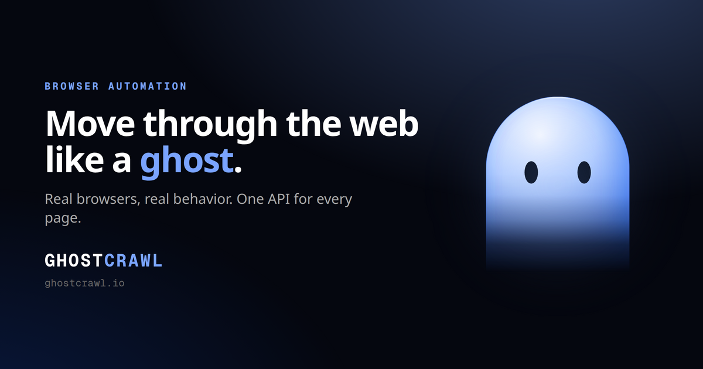

<!-- GitHub social preview image lives at images/github-social.png
     (repo Settings → Options → Social preview). -->

# GhostCrawl

### Move through the web like a ghost.

**GhostCrawl is a cloud browser API for web scraping, crawling, and data extraction.**
Real Chrome, Firefox, and WebKit browsers in the cloud, so your agents and
scrapers get reliable page results without managing a single browser, queue, or exit.

[Website](https://ghostcrawl.io) ·
[Docs](https://docs.ghostcrawl.io) ·
[Try it](https://ghostcrawl.io/#playground) ·
[Ghostopia](https://ghostcrawl.io/ghostopia) ·
[API](https://api.ghostcrawl.io) ·
[MCP](https://mcp.ghostcrawl.io) ·
[Examples](examples/) ·
[☕ Buy me a coffee](https://buymeacoffee.com/ghostcrawl)

⭐ **If GhostCrawl is useful to you, a star helps other developers find it.**

